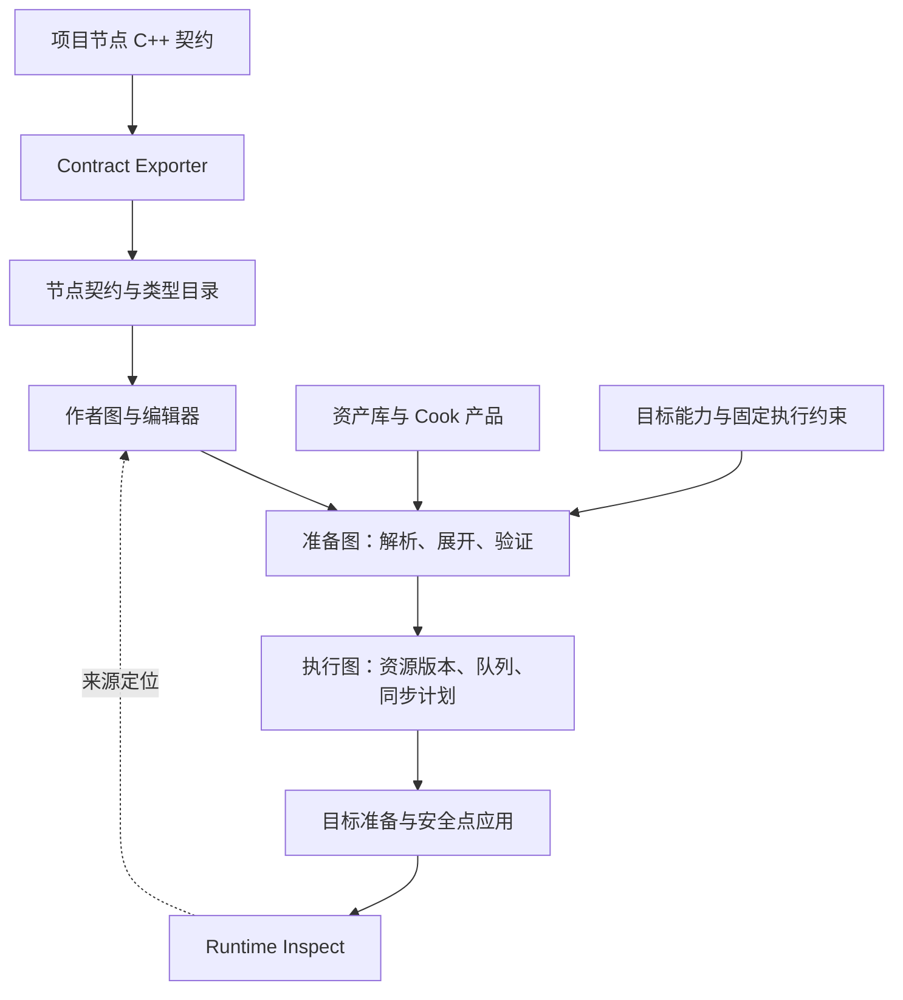
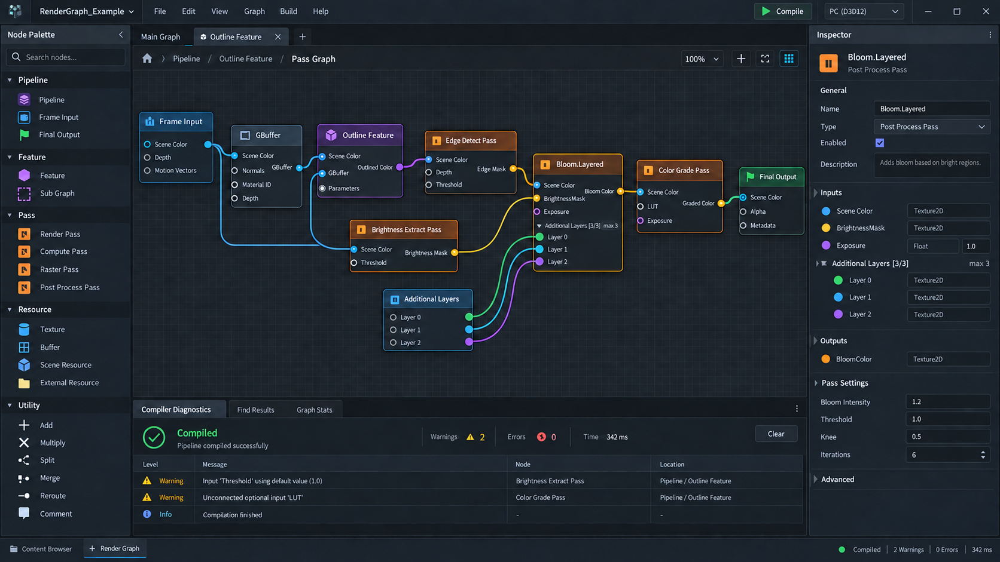

# AEG FlowGraph：统一数据流编排架构

- 中文名称：**AEG 统一数据流编排架构**
- 英文名称：**AEG FlowGraph — Unified Dataflow Orchestration Architecture**
- 适用对象：游戏开发者、节点扩展开发者、引擎与编辑器开发者。
- 文档状态：历史目标设计与概念索引；当前契约以 [Feature 五域架构设计](AEG%20Feature%20Five-Domain%20Architecture.md) 为准，实际操作和已交付范围分别见[编辑器上手指南](aeg-flowgraph/editor-experience.md)与[验收与交付](aeg-flowgraph/validation-and-delivery.md)。
- 原整理日期：2026-09-28；状态说明更新：2026-10-25。

当前实现采用 FeatureGraph-only：正式作者文件为 `.aegfeature`，旧 `.aegpipe`/`.aegframe`
及旧项目启动字段明确拒绝。本文下方保留的兼容 profile、三层交互和迁移条目属于历史目标，
不能用作现行 API 或已实现控件的说明。开发或使用当前编辑器时，优先阅读上述现行指南。

## 1. 架构定位与命名

AEG FlowGraph 将 Feature 作为唯一业务/作者身份，并为不同执行作用域提供可组合的节点与子图。
目标编辑器以一个 Feature Graph 为主模型，五域、Atomic/Composite、Call/Process/Continuous
和状态策略是筛选与契约维度；`Pipeline、Feature、Pass` 只作为 Frame/Render 的兼容投影出现。
Logic 的状态机、跨帧流程和函数调用使用 Feature/Process/State/Transition 语义，不能被强行映射为 RenderPass。
游戏开发者从节点目录选择积木，通过端口连接上游结果和下游输入，形成可保存、可验证、可预览、可追踪的数据流图。

**Flow** 表示结果数据的流动及其生产先于消费的依赖；跨帧 continuation 使用 **Process** 语义，避免与数据 Flow 混淆。**Graph** 表示各 profile 共用的作者契约、端口、诊断和版本基础设施。Feature Graph 可派生出 Frame/Render 的 Pipeline/Pass 执行投影，也可派生 Logic/Physics/Audio/Stream 的各自 ExecutionPlan。名称使用 AEG 前缀，作为项目内架构名称、文档名称和编辑器功能名称的统一依据。技术标识 `Pipeline`、`Feature`、`Pass`、`TypeCatalog`、`RenderGraph` 保持各自职责；FlowGraph 是它们的作者编排层，不替换底层渲染图或领域调度器。

| 名称                      | 规范用途                                   |
|---------------------------|--------------------------------------------|
| AEG FlowGraph             | 架构及功能总称；首次出现使用完整名称       |
| FlowGraph                 | 同一上下文内的简称                         |
| FlowGraph Editor          | 节点图编辑器                               |
| FlowGraph Compiler        | 将作者契约转换为可执行计划的编译职责       |
| FlowGraph Runtime Inspect | 运行图、资源版本、耗时与来源的只读检查入口 |
| Authoring Contract        | 作者图、类型目录和运行映射之间的规范契约   |

这些名称是设计职责名称，不表示仓库已经存在同名模块或公共 API。文件名使用稳定主题，不以修订次数命名。`SchemaVersion`、`ContractVersion`、`GraphVersion` 等是运行和资产协议的一部分，必须继续保留。

## 2. 产品目标与基本约束

主要用户是游戏开发者。图形化编排应让用户理解“节点需要什么、产生什么、数据流向哪里、失败在哪里”，并完成从拼接到观察结果的闭环。

1. 各 profile 共享节点契约、端口、连线、增删、复制、子图导航和诊断体验；Feature Graph 是主视图，Frame/Render 的 Pipeline、Feature、Pass 与 Logic/Process 的 State、Transition、Event、FunctionCall 都是从 Feature 派生的 profile 子视图。
2. 普通连线始终是 `A.Output → B.Input`：A 的结果作为 B 的来源，B 消费该结果的工作必须发生在结果满足完成条件之后。
3. 多条输入边构成汇合依赖。例如 A→B、C→B 要求 B 等待 A 和 C，不额外规定 A 与 C 的顺序。
4. 输入名称、数量、类型、是否可空、来源模式和合并算法由节点类型声明。固定节点不能被实例临时改成任意多输入节点。
5. Variadic 是类型授权的可变槽位；Array 是数据类型。槽位数量、实际数据边数量和数组元素数量分别校验。
6. 必需输入要求有效来源，不要求必有上游边。TextureAsset 节点可以零输入，使用资产参数产生纹理；允许 Asset 来源的消费端口也可直接绑定资产。
7. 文件路径用于导入和选择，图保存稳定 AssetId。填写路径或 AssetId 不代表资源已导入、Cook 完成或设备可用。
8. 保存允许不完整草稿；Compile、Prepare、Apply 分别校验对应阶段的条件。删除不会自动接线、旁路或启用未激活的备用来源。
9. 双击进入节点定义：图资产进入子图，代码节点进入契约工作区并可定位 IDE，系统节点显示只读说明。
10. 编译优化不得改写作者图。实际裁剪、合并、队列与资源复用在 Runtime Inspect 中解释。

## 3. 对象分工

| 对象                        | 图中的职责                          | 可以编辑的内容                                                  | 执行映射                                                                                    |
|-----------------------------|-------------------------------------|-----------------------------------------------------------------|---------------------------------------------------------------------------------------------|
| Feature Graph               | 唯一作者根图及可复用子图容器        | 五域 Feature、Composite、公开输入输出、目标和授权配置           | 按 Domain/Scope/Clock 派生对应 ExecutionPlan                                                |
| Feature                     | 唯一业务/作者身份，父图中的黑盒节点 | 子图中的 Process/State、Render Part、子 Feature、公开接口和参数 | 按公开结果映射到对应 profile 的内部生产者；不自动创建独立调度器                             |
| Pipeline / Pass             | Frame/Render profile 的兼容执行投影 | 派生后的阶段、锚点、端口和参数视图                              | Pipeline 生成计划；Pass 映射到 RenderGraph 资源访问、GPU 工作及结果完成点；不得承载跨帧状态 |
| Resource / Artifact / Value | 资源、业务快照和小型值              | 来源、约束和授权参数                                            | 提供类型、逻辑结果版本、生命周期和访问依据                                                  |
| Graph Input / Output        | 子图与父图或运行目标的边界          | 仅定义编辑者可以修改公开接口                                    | 使用稳定 InterfacePortId 映射输入输出                                                       |

Stage、Phase、Queue、Part 是执行约束，不能由画布位置、节点名称或层级嵌套绕过。Feature
嵌套和跨领域能力属于受控组合；目标作者图统一并不意味着运行时可以执行任意组合。Logic
Process 的 State/Transition/FunctionCall 必须保留 ProcessInstance、StateStore 和 OwnerPath，
不能在静态展开时丢失。准确开放范围见[验收、迁移与交付范围](aeg-flowgraph/validation-and-delivery.md)。

## 4. 系统结构与职责边界

下图表示系统的处理流程，不是作者画布的数据边示例。

| 层或组件                | 拥有的数据与责任                                 | 边界                                                |
|-------------------------|--------------------------------------------------|-----------------------------------------------------|
| Author Graph            | 节点实例、端口绑定、边、子图引用、草稿和布局     | 唯一可编辑的图语义；可保存错误                      |
| Prepared Graph          | 类型与资产解析、子图展开、逻辑资源和有效来源     | 派生候选；不能冒充作者文件或已应用目标              |
| Execution Graph         | 阶段、队列、物理资源计划、内存与执行依赖         | 满足结果先后，同时允许合法并行录制和执行            |
| Runtime Inspect         | 实际调用、输出结果、优化来源、诊断和采集数据     | 只读，不反向修改作者图                              |
| TypeCatalog             | 导出的节点类型、契约、能力、源码映射             | 与运行注册核对 ContractDigest；不通过扫描函数猜节点 |
| Asset Database / Cooker | 稳定 AssetId、内容版本、目标产品、准备状态       | 图引用资产，不持久化 GPU Handle 或机器绝对路径      |
| 模块与应用协调          | 候选构建、目录迁移、目标准备、发布代次、引用排空 | 不混用目录、DLL、回调或资源代次                     |

## 5. 核心协议

### 5.1 来源、端口与类型

每个端口有稳定 PortId、版本化 ValueSchema、AllowedSources 和 PresenceRequirement。实例只有一个活动来源 ActiveSource，可选 Edge、Asset、Literal、Default、Context；只有契约允许缺省时 None 才合法。Optional 是必需性规则，Cancelled 是一次任务的结果状态，两者都不是可替代资产的来源类型。

资源准备中的 Pending 与业务空值分开。可选端口一旦选定上游边，也必须等待该上游，不能因上游失败而偷偷切回默认值。槽位使用稳定 SlotId，排序不改变身份。

### 5.2 先后、完成与资源

CPU 结果发布、GPU 同队列写后读、跨队列交接、GPU→CPU Readback、资产准备有不同完成点。每个输出声明完成域和阶段；GPU 命令录制结束不等于 GPU 结果完成。

逻辑资源身份与结果版本分开。B 修改 A 的结果时必须形成新 ResourceValueVersion；C 若仍消费旧结果，旧结果不能被物理覆盖。编译器处理实际同步、内存可见性和物理资源复用，不能用一条隐藏排序掩盖冲突。

ExecutionToken / WriteReceipt 是声明过类型和完成含义的数据。普通 Token 分叉不能使多个下游自动串行；Sequence 必须有真实内部步骤与完成握手。

### 5.3 调用、失败与状态

ExecutionInstanceId 区分同一图的 View、World、帧、目标与调用路径，AttemptId 区分同一逻辑调用的重试。异步结果必须核对调用、尝试、图及目标代次。Ready、Invalid、Cancelled、Skipped、Partial 分开解释；首期未实现部分结果协议的节点不得声明 Partial 可消费。

History 使用独立 HistoryKey 和失效策略。图、目标、尺寸、格式或 View 改变时必须确定保留、清空或重建行为。有状态代码节点升级时声明 Reset、Migrate 或 Reject。

### 5.4 保存、摘要与迁移

图资产和契约版本用于稳定引用；DraftRevision、LayoutRevision 分别记录语义草稿和布局变化。语义摘要覆盖影响结果的图、节点、来源、资源、目标、编译器和能力配置，排除布局。

保存必须保留未知字段和断线草稿，通过临时文件、完整性校验、原子替换与恢复副本防止半写文件被当作有效图。接口、SlotId、ActiveSource 等语义合并冲突必须显式处理。LegacyOrdering 仅用于读取迁移，正式作者图只写 DataEdge，固定引擎约束单独建模。

### 5.5 扩展与发布

代码节点以 C++ 契约声明/注册为真源，由独立 Contract Exporter host target 导出 TypeCatalog；运行注册调用同一契约函数。DLL、metadata、manifest 的身份与契约必须一致。

首期模块切换采用停止预览、排空引用、重载、重新准备的流程。构建失败保留旧目录和作者数据；模块已停止或卸载后，不承诺旧预览持续运行。预览图切换与模块重载是不同事务，详见[编译与运行生命周期](aeg-flowgraph/compilation-and-runtime.md)。

SideEffect 节点声明保活依据、Receipt、CommitPolicy、RetryPolicy 与幂等条件。已发生的外部写入不能被“恢复旧图”冒充为撤销。缓存、裁剪和合并必须保持结果语义及副作用次数。

## 6. 编辑器与效果参考

布局为左侧节点目录、中央画布、右侧 Inspector、底部诊断和顶部导航/目标状态。输入位于节点左侧，输出位于右侧；连线提示同时显示数据类型、源结果和依赖。工具栏的 Runtime Inspect 以只读方式展示当前活动执行计划，不回写作者图。

本图是历史布局参考。Additional Layers 仅属于声明过该组的示例节点；Inputs 标题旁的通用加号不属于正式交互。图片不作为类型正确性、运行成功或功能已实现的证据。当前实际入口、按钮与操作步骤见[五域编排上手指南](aeg-flowgraph/editor-experience.md)。

## 7. 文档结构与规范职责

本总览及下表中的概念、契约和工程专题保留历史方案。当前 Feature-only 契约以 [Feature 五域架构设计](AEG%20Feature%20Five-Domain%20Architecture.md) 为准；其中三层作者图、兼容迁移和首期范围不能直接用于当前资产。

《五域编排上手指南》和《验收与交付》已按当前实现更新，分别说明实际操作和已验证范围。阅读其他专题中的目标交互时，应先核对这两份文档的实现边界。

| 文档                                                                  | 内容                                               | 建议读者                 |
|-----------------------------------------------------------------------|----------------------------------------------------|--------------------------|
| [概念与数据流模型](aeg-flowgraph/concepts-and-dataflow.md)            | 中英文术语、三种作者图、来源、多输入和数据流       | 所有读者                 |
| [节点与端口规范](aeg-flowgraph/node-and-port-contracts.md)            | 卡片、端口、连接、Variadic、接口、复制删除         | 节点与编辑器开发者       |
| [五域编排上手指南（当前实现）](aeg-flowgraph/editor-experience.md)     | 新工程、泳道、契约检查、Process、预览与运行操作   | 游戏开发者、交互设计者   |
| [作者与执行契约](aeg-flowgraph/authoring-and-execution-contract.md)   | 身份、来源、结果、资源、同步、摘要、发布与优化协议 | 引擎、工具链与节点开发者 |
| [编译与运行生命周期](aeg-flowgraph/compilation-and-runtime.md)        | 编译验证、准备应用、预览、取消、恢复与并发         | 引擎与编辑器开发者       |
| [节点目录与扩展机制](aeg-flowgraph/node-catalog-and-extensibility.md) | 节点来源、功能责任、目录筛选、注册和权限           | 节点及模块开发者         |
| [自定义节点开发工作流](aeg-flowgraph/custom-node-development.md)      | 定义入口、IDE、脚手架、构建目标、契约回流          | 游戏及工具链开发者       |
| [工程衔接与架构约束](aeg-flowgraph/engineering-integration.md)        | 现有代码依据、接入责任、反例与 26 项一致性要求     | 引擎与集成人员           |
| [验收与交付（当前实现）](aeg-flowgraph/validation-and-delivery.md)     | 操作边界、真实点击验收、last-good、发布与复验命令  | 项目、开发与质量人员     |

## 8. 历史交付边界与当前证据

本套文档最初交付架构方案、详细规则和验收设计。方案确认与功能通过验收是两种状态，不能从设计条目推断实现支持。

早期以 Render Pass 和 Pipeline/Feature/Pass 视图描述的首期闭环已由 Feature-only 五域作者入口替代，不再作为当前交付限制或迁移承诺。当前泳道、Contract Inspector、transport 校验、未发布作者预览及其验收证据见[验收与交付](aeg-flowgraph/validation-and-delivery.md)；高级 GPU 调试等后续方向仍须另行实现并验收。
