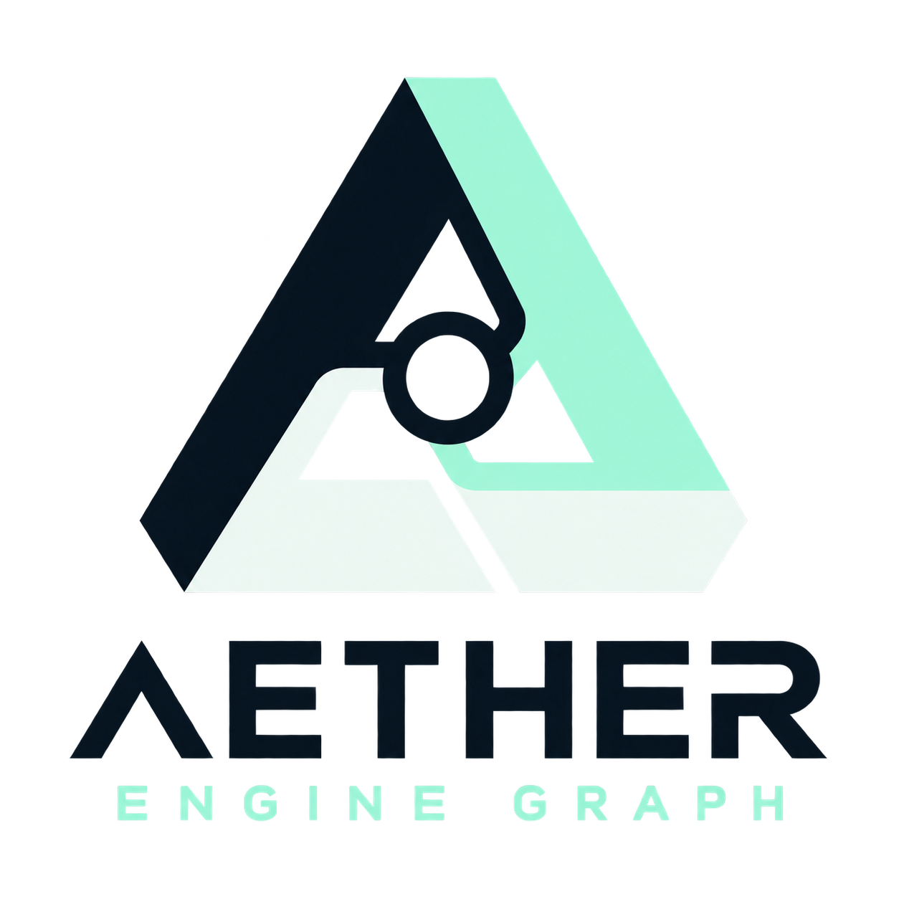

<p align="center">
  
</p>

# AEG Engine

AEG Engine 是一个使用 C++20 构建的模块化游戏引擎与编辑器项目。它以明确的生命周期、显式依赖和
后端无关的系统边界组织 World、Scene、ECS、FeatureGraph、RenderGraph、RHI、资源与编辑器能力。

## 当前能力

- Logic、Physics、Render、Audio、Stream 五域 Feature 与 Artifact 依赖编排
- 显式 Clock 合同、宿主能力与工作量准入、phase 调度和跨 Clock 消费期限
- ECS World、不可变快照、Scene 文档、层级和序列化
- 后端无关 RHI、Vulkan 后端、RenderGraph 与资源上传
- ImGui 编辑器工作区、Scene Viewport、Hierarchy、Inspector、Assets 与 FeatureGraph 编辑
- C++ 模块注册、反射、日志、数学、并发与平台适配

## 构建

Windows 构建需要 CMake 3.25+、C++20 编译器、Vulkan SDK 和 DXC。第三方源码与离线归档
随仓库提供，详见 [`ThirdParty/README.md`](ThirdParty/README.md)。构建不会从系统安装位置
解析 nlohmann/json、toml11 或 FlatBuffers。

```powershell
cmake -S . -B build -G Ninja -DCMAKE_BUILD_TYPE=Debug
cmake --build build --target aeg_editor_application
```

启动编辑器：

```powershell
.\build\AetherEngine.exe
```

也可以显式打开游戏项目：

```powershell
.\build\AetherEngine.exe --project E:\Projects\MyGame\Project.aegproj
```

以上命令使用 Ninja 单配置构建。Visual Studio 等多配置构建需加 `--config Debug`，
对应程序通常位于 `build/Debug/AetherEngine.exe`。

## 第一次使用编排器

通过 **File > New Project...** 创建项目后，打开左侧 **Flow Graph**，选择 **Gameplay starter**。
先点 **Check draft > Validate draft / Compile preview**，再用 **Process editor** 编辑
`Ready → Running → Done` 状态图。作者预览无需 DLL；运行实现则需要构建并加载模块。
模板演示状态编排，场景物体需另行添加。

完整操作、五域泳道、transport 和 last-good 状态见[编辑器上手指南](aeg-flowgraph/editor-experience.md)。

## 游戏工程扩展

游戏工程通过 `EngineTools.cmake` 以内联源码方式接入引擎。当前作者模型以 Feature 为唯一
功能单元、以 Logic/Physics/Render/Audio/Stream 五域分类；Atomic/Composite、Call/Process/
Continuous 和状态策略彼此正交。Frame/Render 的 Pipeline、Stage、Task、RenderPass 只作为
内部执行投影，详见 [Feature 五域架构设计](AEG%20Feature%20Five-Domain%20Architecture.md)。

```powershell
$engine = (Resolve-Path .).Path
cmake -S MyGameProject -B MyGameProject/Build/Debug "-DENGINE_DIR=$engine"
cmake --build MyGameProject/Build/Debug --config Debug --target MyGameExecutable
```

Cooker 会把 `.aegfeature` 和启动场景写入 `game.aegbin`，Shipping 启动时校验 Build ID、模块
契约摘要、动态模块 bundle、包摘要和所有启动 FeatureGraph 的语义。编辑器的 World route
sidecar 随 Cook 进入 manifest，运行时在首次 callback 前完成精确 owner/entity 绑定。
第三方依赖已随仓库放在 `ThirdParty/`，
无需从系统目录或网络临时下载。

作者 Clock 使用显式 capability version、phase、deadline policy 和预算；声明由宿主审核。
模块 metadata 与 GameSDK contract 为 major3，Feature-only Module ABI 为 major2，执行 API/AFR1 为 v2。
Clock 与跨域提交边界详见 [Feature 核心说明](Engine/Feature/README.md)及
[Clock 合同设计](docs/superpowers/specs/2026-10-18-clock-contract-and-transport-design.md)。

## 文档

2026-10-25 五域编辑器交互与交付补强已完成：Debug 完整 CTest **248/248 通过，0 失败，
525.25 秒**。包括真实点击 Validate/Compile、非法草稿的 stale last-good、项目启动、
源码目录和 Cook 缓存回归，见[最新验收记录](docs/superpowers/plans/2026-10-24-orchestration-interaction-acceptance.md)。
2026-10-18 原主线验收作为[历史矩阵](docs/superpowers/plans/2026-10-18-five-domain-final-acceptance.md)保留；
验收数字对应各次记录中的工作树，不代表后续修改自动通过。

- [编辑器五域编排上手指南](aeg-flowgraph/editor-experience.md)
- [验收、预览与交付边界](aeg-flowgraph/validation-and-delivery.md)
- [Feature 五域架构设计（目标模型与迁移规范）](AEG%20Feature%20Five-Domain%20Architecture.md)
- [引擎开发契约](AEG%20Engine%20Contracts.md)
- [Feature 开发示例（创建、实现、参数与模块接入）](feature-development-example.md)
- [Domain-Oriented Pipeline Architecture](AEG%20Domain-Oriented%20Pipeline%20Architecture.md)
- [编辑器启动与演示](Application/Editor/README.md)

## 资产目录边界

`Engine/Asset` 只放运行时必须共享的资产 ABI：Asset UUID/类型、Cooked envelope
与 FlatBuffers schema、`.aegbin` Reader、句柄和 payload 解码。`Application/Tooling`
放源资产 `.meta`、Importer、Cook cache、依赖遍历和 package Writer。Tooling 可以调用
Engine 的编解码接口，但 Engine 不依赖 Tooling；因此“资产由 Application 生成”不等于
“资产运行时契约属于 Application”。

通用向量、矩阵、四元数、变换、投影和几何算法统一位于
[`Engine/Math`](Engine/Math/README.md)，由 `aeg_math` 提供；上层
模块不得复制这些基础类型。

Logo 与品牌资源位于 [`Assets/Branding`](Assets/Branding/)。

发布回归会在隔离目录运行 120 帧，并检查包外没有 Source 或 Editor 依赖：

```powershell
ctest --test-dir build -C Debug --output-on-failure -R "^aeg_game_project_runtime$"
```

## 开源协议

Copyright 2026 AEG Engine contributors.

本仓库原创代码、文档与示例采用 [Apache License 2.0](LICENSE)，允许商业使用、修改和
闭源分发，并包含贡献者对其贡献所涉及的必要专利的授权。使用本引擎开发的独立游戏与
应用可以采用自己的许可证。

分发本项目或衍生作品时，应附带协议全文、保留适用的版权和 [NOTICE](NOTICE) 声明，
并在修改过的文件中标明修改。完整条款以 [LICENSE](LICENSE) 为准。

第三方代码和字体保留各自的许可证，详见 [第三方依赖与许可说明](ThirdParty/README.md)。
本项目使用 FreeType 的 FTL 授权选项，相关致谢见 [NOTICE](NOTICE)。
