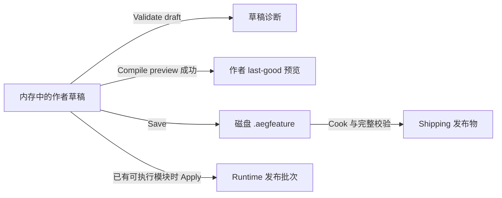

# AEG FlowGraph：五域编排上手与编辑器操作

[返回架构索引](<../AEG FlowGraph Architecture.md>) · [五域契约](<../AEG Feature Five-Domain Architecture.md>) · [验收与交付](validation-and-delivery.md)

本页描述 2026-10-25 已实现的编辑器操作。作者资产是 `.aegfeature`，节点来自
FeatureCatalog；Logic、Physics、Render、Audio、Stream 是域分类。Frame/Render 的
执行计划与 RenderGraph 属于只读观察视图。

## 1. 新建项目后，先完成一次预览

1. 通过 **File > New Project...** 创建项目，点击主窗口左侧 **Flow Graph**。
   独立窗口显示当前 `.aegfeature`；多张有效图可通过 **Select FeatureGraph** 切换。
   有未保存修改时先 Save 或撤销修改，再切换图。
2. 默认图 `Assets/Features/Default.aegfeature` 已包含 **Gameplay starter**，其定义是
   `Game.Logic.Gameplay`，执行策略为 Logic / Process。点击画布节点或 Logic 泳道中的投影。
3. 点击顶部 **Check draft** 跳到 **Five-domain orchestration**，查看 **Contract Inspector**。
   点击 **Validate draft**，合法默认图显示 `Draft validation passed`。
4. 点击 **Compile preview**，看到 `Authoring preview compiled` 和 `Preview: last-good`。
   这两步使用项目中的离线契约目录，无需先构建或加载 DLL。
5. 保持节点选中，点击 **Process editor**，查看 `Ready → Running → Done` 状态图。
   该快捷入口将所选节点设为 Process owner；也可使用 **Use selected as Process owner**。
6. 修改状态或连接后再次 Validate/Compile，使用 **Save** 保存作者图。

新项目的 Scene 没有场景物体；默认示例展示状态编排。目录中的 **Outline contract example**
是 `Game.Render.Outline` 的契约示例，其 callback 没有绘制实现，添加它不会产生 Outline 效果。
Gameplay 示例没有数据端口，状态转移应在 Process 状态图内编辑。

## 2. 每个入口解决什么问题

| 入口或区域 | 用途 |
|---|---|
| **Node catalog** | 跳到 Feature Catalog，按名称、完整 Definition ID、Domain、Execution、Structure、Scope、Clock 查找契约，再点 **Add node** |
| **Feature graph canvas** | 选择、移动、复制、删除节点，从输出端口拖到输入端口连接 |
| **Check draft** | 跳到五域泳道、契约检查器、Validate/Compile 和 transport 诊断 |
| **Process editor** | 编辑所选 Process owner 的状态、入口、终态和转移 |
| **Feature definitions** | 显式打开定义工作区，创建、检查、保存或生成 Feature 契约与实现骨架 |
| **Edit selected definition** | 从 Contract Inspector 打开当前 Definition |
| **Frame / Render (read-only)** | 展开查看实际运行的执行计划和成功帧；默认折叠 |
| **Show ExecutionPlan / Show RenderGraph** | 查看已发布根和成功 RenderGraph 的实际来源；不是草稿编译结果 |

普通滚轮滚动窗口中的作者控件；固定窗口 chrome 和根图选择器不随内容移动。
需要找下方控件时优先使用顶部跳转按钮。

## 3. 五域泳道与契约检查

| 域 | 分类含义 |
|---|---|
| Logic | 玩法规则、状态流程、业务意图 |
| Physics | 物理模拟、空间约束和碰撞 |
| Render | 图形资源与呈现工作 |
| Audio | 声音处理和播放 |
| Stream | 异步数据、网络或文件流 |

泳道显示当前作者草稿中的域投影。Composite 可出现在多个域中，所有投影仍对应同一个
作者 NodeId。点击任一投影会更新共享选择，画布的聚焦和删除也作用于这个节点。
点击画布空白处可清除选择；选择本身不生成作者事务。

Contract Inspector 从版本匹配的契约读取 Domain、Atomic/Composite、Call/Process/Continuous、
StatePolicy、Scope、Clock、模块 owner、作者 owner path、端口、子 Feature 和 Process 摘要。
发现旧版本节点时显示 stale contract，需核对定义版本后再连接或编译。

可读名称来自项目的 Editor 合同旁车，只有 ID、owner、版本和契约摘要匹配时才用于展示。
名称、端口标签不会改变契约；不同 Definition 可以同名，应结合完整 ID 定位。
目录为空时，先检查所选项目及其配置的源码目录、metadata 和定义诊断。

## 4. 添加节点与连接端口

1. 点击 **Node catalog**，找到需要的契约，再点 **Add node**。
2. 在画布的 **Connection kind** 选择边类型，再从输出端口拖到目标输入端口。
3. Queue 设置正数 **Capacity**；Snapshot 设置正数 **Deadline ticks**。
   deadline 的单位是源 Clock 的周期，不是渲染帧数或毫秒。
4. 查看 **Cross-domain edges / transport diagnostics** 中的关系、两端域/Clock、transport、
   capacity、deadline 和生产校验器诊断，然后 Validate/Compile。

| 连接情况 | 要求 |
|---|---|
| Data | 有效输出到输入；端口 schema、版本匹配，使用端口对应的相同域和 Clock |
| 跨域或跨 Clock | 采用显式 transport，不能用 Data 绕过边界；仍须满足两端端口和 Clock 契约 |
| Snapshot | 必须有正数 deadline；适合按声明的时间边界消费快照 |
| Queue | 必须有正数 capacity；按队列契约处理积压 |
| Event / Command / Receipt | 使用对应传输语义和类型契约，不是通用执行引脚 |

画布会拒绝不合法的新连线并报告原因。若非法边已来自导入或外部修改，当前草稿仍会显示该边，
Compile 会阻断。诊断中的 Node、Port、Edge、OwnerPath 用于定位；不要通过改显示名或随意填写
Clock ID 来消除错误。Composite 端口还必须有合法的子端口映射。

## 5. 编辑 Process 状态图

Process 属于一个 Feature 节点，并非另一种作者根图。选择 Process 节点后进入 **Process editor**：

- 使用 **New state / Add state** 添加状态。
- 从状态输出点拖到另一状态，或填写 **Transition from / Transition to** 后点 **Add transition**。
- 使用列表中的 **Set initial** 或画布的 **Make selected entry** 设置入口；通过列表 **Terminal** 或画布 **Explicit terminal** 标记终态。
- 使用 **Auto layout states**、缩放和平移整理布局；拖动状态在释放时提交，Esc 取消预览。
- 删除状态或转移后重新校验。每个 owner 只能有一个 Process 子图。

状态、转移和入口/终态修改进入 Undo/Redo。纯布局只改变布局版本，Cook 会移除 Editor 布局扩展。
默认 Gameplay callback 处理 Ready→Running 和 Running→Done；修改这些业务状态或转移时，
还要相应修改 `Source/GameModule.cpp` 的实现并重建模块。两个符合条件的 Logic invocation
可以推进这两个转移，不能把它理解为固定两个画面帧。

## 6. Validate、Compile、Save 和运行的区别

| 操作 | 输入与结果 |
|---|---|
| **Validate draft** | 检查当前草稿，显示诊断；不会建立成功编译缓存 |
| **Compile preview** | 建立作者预览及其 provenance；不调用 Feature callback、不发布 Runtime generation，也不证明 GPU 效果已经实现 |
| **Save** | 保存作者数据、布局与扩展；不构建 C++、不加载模块 |
| **Build > Build / Cook... > Build** | 构建游戏模块及发布 metadata/manifest；失败保留上次成功 bundle |
| **Load Module** | 校验并装载模块；已有活动根时保留其完整批次，无活动根时读取已保存 startup roots，再在 Scene 帧边界发布 |
| **Load Saved Project** | 明确重读项目文件中的完整有序 startup roots；不会替换当前作者草稿 |
| **Apply** | 使用当前作者图排队完整 FeatureGraph 发布批次；需要真实 executable module，发布仍要通过 Runtime 校验 |
| **Play** | 推进场景模拟和符合条件的 Logic Clock；Pause 停止新模拟推进，已发出的完成仍可能被回收 |
| **Cook / Build and Cook** | 从已保存的项目配置与源码资产生成交付包，完成校验后切换 Shipping selector |

在没有加载 executable module 时，主面板 Apply 禁用，但作者校验和预览仍可用。
代码或模块契约变更后应构建新 bundle；已有模块升级时按界面执行 **Review Contract Changes**，
审查差异后再加载。发布目录中的实际 manifest 路径以当前项目配置和构建结果为准。

## 7. 读懂 last-good 与 stale

| 当前情况 | 作者预览表现 |
|---|---|
| 刚打开图，尚未成功 Compile | `Preview unavailable until Compile preview succeeds.`；仍显示当前草稿的泳道和诊断 |
| Validate 成功 | `Draft validation passed`；不会隐式生成 last-good |
| Compile 成功 | `Authoring preview compiled`，`Preview: last-good` |
| 草稿语义、目录摘要等改变 | 旧成功结果保留并标为 `last-good (stale)` |
| 存在非法边等错误后 Compile | `Compile preview blocked`；当前非法草稿继续可见，旧成功结果单独保留 |
| 尚无成功结果就 Compile 失败 | 显示失败诊断，不伪造成功预览 |
| 切图或重新打开文档 | 清除旧文档的作者预览缓存，需重新 Compile |

当前草稿和 **Compiled authoring preview - last successful result** 是两份视图。错误时要修当前
草稿中的节点/边，不能把旧 provenance 当成新图已经通过。纯布局调整不改变图语义。

作者预览、Runtime 已发布批次、模块 bundle、Shipping selector 分别维护自己的 last-good。
Compile 成功不等于 Apply 成功；失败 Cook 保留上次交付选择器，也不表示所有导入缓存都回滚。
这些边界及复现验收见[验收与交付](validation-and-delivery.md)。

## 8. 画布操作

| 操作 | 当前入口 |
|---|---|
| 选择 / 多选 | 单击节点；Ctrl+单击多选 |
| 移动 | 拖动节点标题；释放提交一次布局事务，Esc 取消 |
| 平移 | 中键拖动，或空格+拖动 |
| 缩放 | Ctrl+滚轮；Zoom - / Zoom + |
| 整理 / 聚焦 | Layout nodes、Frame all (A)、Focus selected (F)、Reset view |
| 复制 / 删除 | Ctrl+D、Delete；复制保留选区内部边 |
| 撤销 / 重做 / 保存 | 面板 Undo、Redo、Save |

画布快捷键在获得焦点且没有文本输入/弹出菜单抢占时生效。使用面板按钮处理文档历史，
不要把窗口滚动或节点选择当成语义编辑。

## 9. 常见问题

| 现象 | 先检查什么 |
|---|---|
| Scene 看起来为空 | 模板只提供 Gameplay 状态编排；进入 Flow Graph，场景物体需另行添加 |
| 只有 Logic 泳道有节点 | 默认示例就是 Logic/Process；其他域需添加实际声明该域的 Feature |
| 目录只有数字或缺少名称 | 检查配置源码目录下的匹配 metadata/合同旁车；完整 ID 始终是身份依据 |
| 跨域连线失败 | 检查 Connection kind、schema/version、Clock、Snapshot deadline 或 Queue capacity |
| Compile 成功但没有游戏效果 | 检查执行实现、模块加载、发布批次与模拟状态；Outline 示例没有绘制实现 |
| 保存后 Cook 仍失败 | 查看实际诊断和契约摘要；启动资产指纹会处理源码变更，不要以删除缓存代替修正非法图 |
| Source 改为 Native 后目录不对 | 检查所选 `.aegproj` 的 `paths.source`，并刷新作者目录；多项目根须显式选择项目文件 |

## 10. 设计扩展与实现证据

拖线到空白处弹出兼容节点菜单、通用右键节点库、Reroute、注释框、自动接口提取、
任意选区转换为 Composite，以及通用 Graph Input/Output 资产绑定工作流，不能仅凭历史设计图
当成当前可用入口。本页列出的按钮和操作以当前实现为准；契约扩展的设计见[节点与端口规范](node-and-port-contracts.md)。

实现入口：[FeatureGraph 面板](../Application/Editor/private/composition/editor_feature_graph_panel.cpp)、
[主画布](../Application/Editor/private/composition/editor_feature_graph_canvas.cpp)、
[作者预览](../Application/Editor/private/composition/editor_feature_graph_preview.cpp)。
最近一次完整实现验收为 **2026-10-25：248/248 CTest 通过，525.25 秒**，
记录见[交互验收计划与证据](../docs/superpowers/plans/2026-10-24-orchestration-interaction-acceptance.md)。
这是该次代码验收记录，不代表以后任何工作树自动通过。
